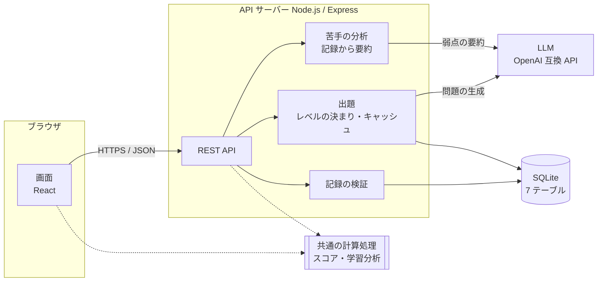
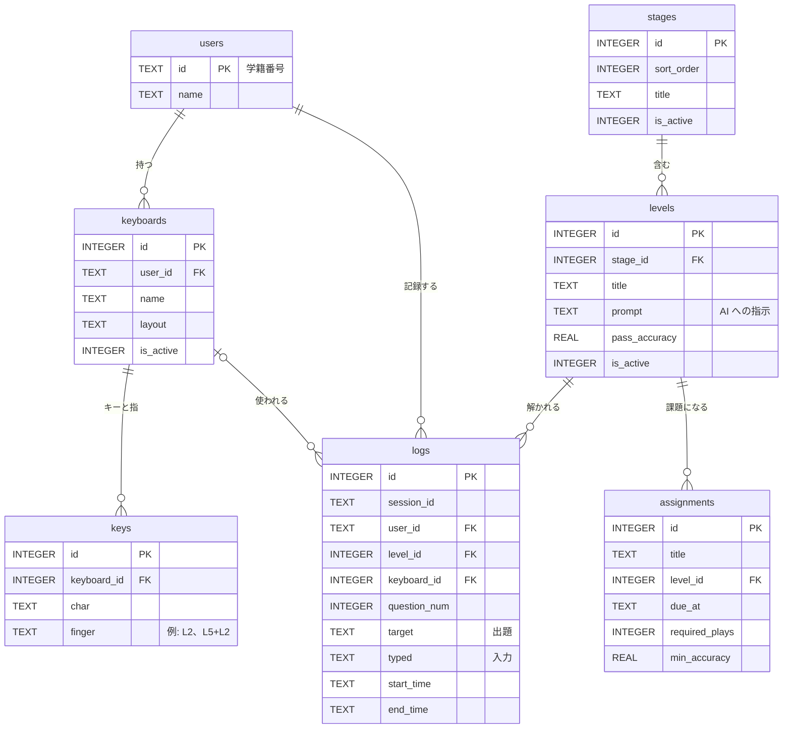

# タイピング練習・学習分析 Web システム

[](https://github.com/y220020-lgtm/typing-portfolipo/actions/workflows/ci.yml)

大学の授業での利用を想定した、タイピング練習と学習分析の Web アプリケーションです。
卒業研究として、要件とデータベースの設計から、Web システムの実装・テストまでを行いました。

学生は練習するだけで、1 問ごとの記録が自動で蓄積されます。その記録から、学生は自分の上達と苦手を、教員はクラス全体の学習状況を確認できます。
AI（OpenAI 互換の LLM）が、レベルに合った問題や、学生ごとの苦手を克服するための問題を作ります。

## 主な機能

**学生**

- 学籍番号でログインし、ステージ・レベルを選んで 10 問ずつ練習（英字・記号・ローマ字・ひらがな・カタカナ・漢字・プログラムの 1 行など）
- 練習中の画面のキーボードで、次に打つキーと担当の指を表示（JIS・US・Keyball44・自由な配列）
- 結果画面（WPM・正確率・問題ごとのミスの位置）、間違えた問題だけの再挑戦
- これまでの記録（WPM・正確率の推移、間違えやすい文字、指ごとのミス率）
- 苦手克服トレーニング：記録から弱点を要約して LLM に渡し、弱点を補う問題と分析文を作る
- レベルごとの苦手克服：そのレベルの範囲（例: 上の段のキーだけ）で、苦手を補う問題を作る
- キーボードの設定：キーと担当の指の割り当て。画面に出る文字に対して実際に使うボタンを押して登録でき、どんなボタンの組み合わせ（同時押し）にも対応

**教員**

- 学生一覧（プレイ回数・成績・最後の練習）、学生ごとの学習分析、クラス全体の苦手
- 全記録の CSV 出力（記録から計算したスコア付き）
- ステージ・レベルの管理（表示順・説明・AI への指示文・合格の目安）、課題（締め切り・回数・正確率の条件）
- 学生と同じ画面で練習（教員の記録は学生の集計に入れない）

## 技術構成

| 区分 | 使用技術 |
|---|---|
| 言語 | TypeScript（サーバー・画面・共通の計算処理で共有） |
| 画面 | React 19、Vite |
| API サーバー | Node.js 22、Express 5（REST API 35 本） |
| データベース | SQLite（better-sqlite3）。7 テーブル |
| AI | OpenAI 互換の Chat Completions API（vLLM 上の Qwen で動作確認）。開発・テスト用の AI モック（依存なしの Node.js） |
| テスト | Vitest（単体・API 292 件）、Playwright（E2E 23 件） |
| 配置 | Podman のコンテナ（アプリ ＋ AI モック）、oauth2-proxy による SSO（`AUTH_MODE=proxy`）、サブパス配下での動作 |

## 全体の構成



画面はデータベースに直接つながず、すべて API を経由します。LLM との通信もサーバーだけが行い、API キーを画面に渡しません。

## データベース



詳しい定義と設計の理由は [`db/データベース仕様書.md`](db/データベース仕様書.md) にあります。

## 設計で工夫した点

1. **1 問 = 1 レコードで生データを残す**
   出題文・実際の入力・開始と終了の時刻だけを保存し、WPM や正確率などの計算結果は保存しません。評価のルールを変えても、過去の全記録を計算し直せます。計算処理は画面とサーバーで共有し、表示・集計・CSV で同じ値になります。
   → [`app/shared/score.ts`](app/shared/score.ts)、[`app/shared/analysis.ts`](app/shared/analysis.ts)
2. **記録の改ざん防止をデータベース側でも保証**
   記録の表への UPDATE と DELETE をトリガーで拒否します。API でも、問題番号の順序・実在する日時・未来の時刻などを保存前に検証します（記録を後から直せないため）。
   → [`db/schema.sql`](db/schema.sql)（`logs_no_update`・`logs_no_delete`）、[`app/server/app.ts`](app/server/app.ts)（`POST /api/logs`）
3. **AI の出力を信用しすぎない**
   AI の返答は、最初の JSON 配列だけを読み、打てる文字で 40 文字以内のものだけを使います。さらに、AI がレベルの指示を守らないことがあったため（例: 「上の段」の練習に下の段の文字）、レベルごとの決まり（使ってよいキーや文字の種類）で選び直し、足りない分は決まりに合う問題で補います。AI が使えないときも、決まりに合う問題で練習を続けられます。
   → [`app/server/aiQuestions.ts`](app/server/aiQuestions.ts)（返答の読み取り）、[`app/server/levelRules.ts`](app/server/levelRules.ts)（レベルの決まり）
4. **費用と待ち時間を抑える**
   AI との通信はサーバーだけが行い（API キーを画面に渡さない）、生成した問題はレベルごとに一定時間キャッシュします。同じレベルへの同時アクセスは 1 回の問い合わせにまとめます。
   → [`app/server/aiQuestions.ts`](app/server/aiQuestions.ts)（`AiQuestionSource`）
5. **どんなキーボードにも対応**
   キーの割り当ては「キーの名前と担当の指」で保存し、同時押しは `L5+L2` のように指を組み合わせて表します。練習の記録があるキーボードは、過去の分析が変わらないよう割り当てを変更できません。登録の画面では、画面に出た文字ごとに実際に使うボタン（どんな組み合わせでも）を押して登録でき、同じボタンを 2 つの文字に使うと止めます。
   → [`app/web/src/keyCapture.ts`](app/web/src/keyCapture.ts)、[`app/web/src/KeyCapture.tsx`](app/web/src/KeyCapture.tsx)
6. **安全な SSO 連携**
   SSO のときは、前段の oauth2-proxy が付けるメールアドレスのヘッダーを、プロキシとアプリだけが知る合言葉のヘッダーが付いた要求に限って信じます。偽のプロキシを使った E2E で、なりすましが拒否されることを確認しています。
   → [`app/server/auth.ts`](app/server/auth.ts)、[`app/e2e/sso.spec.ts`](app/e2e/sso.spec.ts)
7. **苦手に合わせた問題**
   記録から文字ごと・指ごとのミス率と難しさの段階を計算し、計算できる項目だけを要約して LLM に渡します（個人の情報や 1 打ごとの操作は渡しません）。LLM が使えないときは、苦手な文字を含む問題を規則で作ります。
   → [`app/server/training.ts`](app/server/training.ts)

## 動かし方

Node.js 22 が必要です。

```bash
cd app
npm ci
npm run db:init    # 開発用 DB（app/data/dev.db）をデモ用のデータで作る
npm run dev        # API（3000 番）と画面（5173 番）を起動
```

ブラウザで `http://localhost:5173` を開き、学籍番号 `y220020` でログインします。
教員の画面を試す場合は、`TEACHER_IDS=t001 npm run dev` で起動し、`t001` でログインします。

AI を使う場合は、OpenAI 互換の API を指定します（指定しなければ、レベルの決まりに合う問題で出題します）。

```bash
AI_BASE_URL=https://（API の URL）/v1 AI_MODEL=（モデル名） AI_API_KEY=（キー） npm run dev
```

コンテナで動かす方法は [`container/README.md`](container/README.md) にあります。

## テスト

```bash
cd app
npm test              # 単体・API のテスト（Vitest）
npm run typecheck     # 型チェック（strict）
npm run format:check  # 書式の確認（Prettier）
npm run test:e2e      # ブラウザでの通しのテスト（Playwright。初回は npx playwright install）
```

GitHub Actions（[`.github/workflows/ci.yml`](.github/workflows/ci.yml)）で、push と pull request のたびに型チェック・書式の確認・単体テスト・ビルド・E2E を実行します。

| 種類 | 内容 |
|---|---|
| 単体 | スコアと学習分析の計算、AI の返答の読み取り、レベルの決まり、キーの登録の判定など |
| API | supertest で、ログイン・権限・記録の検証（不正な日時・順序・未来の時刻）・課題・CSV など |
| E2E | Playwright で、ログインから練習・結果・教員の画面までの通し、AI モック・偽の SSO プロキシ・コンテナを使った構成 |

## ディレクトリ構成

```
app/
  server/     API サーバー（Express）。出題・AI 連携・認証・記録の検証
  shared/     画面とサーバーで共有する計算処理（スコア・学習分析・合格判定）
  web/src/    画面（React）
  e2e/        ブラウザでの通しのテスト（Playwright）
  seed/       開発用の初期データ
db/           データベースの定義（schema.sql）と設計の文書
docs/         システム設計書
container/    コンテナで動かす仕組み（アプリ ＋ AI モック）
```

- データベースの設計: [`db/データベース説明.md`](db/データベース説明.md)、[`db/データベース仕様書.md`](db/データベース仕様書.md)、[`db/schema.sql`](db/schema.sql)
- システムの設計（構成・機能・API・画面）: [`docs/システム設計書.md`](docs/システム設計書.md)
- API の一覧と設定: [`app/README.md`](app/README.md)

## 開発の経緯と分担

- 2025 年 11 月から要件の検討とデータベースの設計を始め、2026 年 4 月に要件定義とデータベース仕様書をまとめました。
- 2026 年 10 月から、このデータベースを使う Web システムを実装しました。実装とテストには AI のコーディング支援（Claude Code）を使っています。何を作るか・どう直すかの指示、試用での不具合の発見、動作の確認は自分で行いました。
- このリポジトリは、研究で使っているリポジトリ（コミット 100 件以上）から、提出用に必要なファイルを抜き出したものです。研究室の内部の記録と、利用者の記録を含むデータベースの実物は含めていません。そのため、コミットの履歴は、提出用に機能のまとまり（データベース → サーバー → 画面 → テスト → コンテナ → CI → 文書）ごとに分け直したものです。
