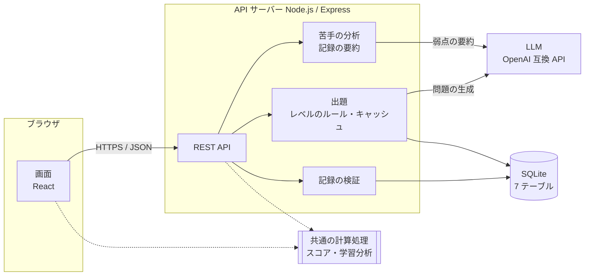
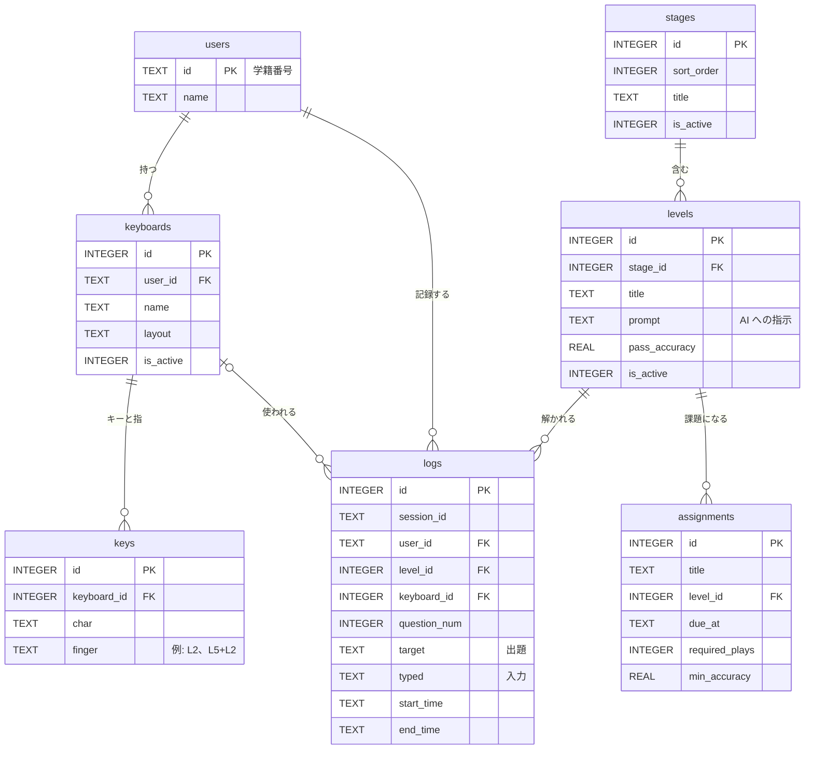

# タイピング練習・学習分析 Web システム

[](https://github.com/y220020-lgtm/typing-portfolipo/actions/workflows/ci.yml)

大学の授業で使うことを想定した、タイピング練習と学習分析のための Web アプリケーションです。
卒業研究として、要件定義とデータベース設計から、Web システムの実装とテストまでを行いました。

学生が練習すると、1 問ごとの記録が自動的に蓄積されます。学生はその記録から自分の上達や苦手を確認でき、教員はクラス全体の学習状況を把握できます。
また、AI（OpenAI 互換の LLM）が、各レベルに合った問題や、学生一人ひとりの苦手を克服するための問題を生成します。

## 主な機能

**学生向け**

- 学籍番号でログインし、ステージとレベルを選んで 10 問ずつ練習できます（英字、記号、ローマ字、ひらがな、カタカナ、漢字、プログラムの 1 行など）。
- 練習中は画面上のキーボードに、次に打つキーと、そのキーを担当する指を表示します（JIS 配列、US 配列、Keyball44、自由な配列に対応）。
- 結果画面では、WPM、正確率、問題ごとのミスの位置を確認でき、間違えた問題だけをもう一度練習できます。
- これまでの記録として、WPM と正確率の推移、間違えやすい文字、指ごとのミス率を表示します。
- 苦手克服トレーニングでは、記録から弱点を要約して LLM に渡し、弱点を補う問題と分析コメントを生成します。
- レベルごとの苦手克服では、そのレベルの範囲内（例：上段のキーだけ）で、苦手を補う問題を生成します。
- キーボードの設定では、各キーをどの指で押すかを登録できます。画面に表示された文字に対して実際に使うキーを押すだけで登録でき、複数のキーの同時押しにも対応しています。

**教員向け**

- 学生一覧（練習回数、成績、最終練習日時）、学生ごとの学習分析、クラス全体の苦手を確認できます。
- すべての記録を、計算したスコア付きの CSV として出力できます。
- ステージとレベル（表示順、説明、AI への指示文、合格基準）と、課題（締め切り、回数、正確率の条件）を管理できます。
- 学生と同じ画面で練習できます。教員の記録は、学生の集計には含めません。

## 技術構成

| 区分 | 使用技術 |
|---|---|
| 言語 | TypeScript（サーバー、画面、共通の計算処理で共有） |
| フロントエンド | React 19、Vite |
| API サーバー | Node.js 22、Express 5（REST API 35 本） |
| データベース | SQLite（better-sqlite3）、7 テーブル |
| AI | OpenAI 互換の Chat Completions API（vLLM 上の Qwen で動作確認済み）。開発・テスト用に、外部ライブラリに依存しない AI モックを Node.js で作成 |
| テスト | Vitest（単体・API テスト 292 件）、Playwright（E2E テスト 23 件。うち通常構成の 16 件を CI で実行） |
| デプロイ | Podman コンテナ（アプリと AI モック）、oauth2-proxy による SSO（`AUTH_MODE=proxy`）、サブパス配下での動作 |

## システム構成



画面からデータベースへは直接アクセスせず、すべて API を経由します。LLM との通信もサーバー側だけで行うため、API キーが画面（ブラウザ）に渡ることはありません。

## データベース



テーブルの詳しい定義と設計の理由は、[`db/データベース仕様書.md`](db/データベース仕様書.md) に記載しています。

## 設計で工夫した点

1. **1 問ごとに生データを保存する**
   保存するのは、出題文、実際の入力、開始時刻と終了時刻だけで、WPM や正確率などの計算結果は保存しません。そのため、評価の方法を変えても、過去のすべての記録を新しい方法で計算し直せます。計算処理は画面とサーバーで共通化しており、画面表示、集計、CSV のどこでも同じ値になります。
   → [`app/shared/score.ts`](app/shared/score.ts)、[`app/shared/analysis.ts`](app/shared/analysis.ts)
2. **記録の改ざんをデータベース側でも防ぐ**
   記録テーブルに対する UPDATE と DELETE を、トリガーで拒否しています。記録は後から修正できないため、API でも保存前に、問題番号の順序、日時が実在するか、未来の時刻でないかなどを検証しています。
   → [`db/schema.sql`](db/schema.sql)（`logs_no_update`、`logs_no_delete`）、[`app/server/app.ts`](app/server/app.ts)（`POST /api/logs`）
3. **AI の出力をそのまま使わない**
   AI の返答からは最初の JSON 配列だけを読み取り、キーボードで入力できる 40 文字以内の文字列だけを問題として使います。また、AI がレベルの指示を守らないことがあったため（例：「上段」の練習に下段の文字が含まれる）、レベルごとのルール（使ってよいキーや文字の種類）で問題を選び直し、不足分はルールに合う問題で補っています。AI が使えない場合も、ルールに合う問題で練習を続けられます。
   → [`app/server/aiQuestions.ts`](app/server/aiQuestions.ts)（返答の読み取り）、[`app/server/levelRules.ts`](app/server/levelRules.ts)（レベルのルール）
4. **AI の利用コストと待ち時間を抑える**
   AI との通信はサーバー側だけで行い、生成した問題はレベルごとに一定時間キャッシュします。同じレベルに同時にアクセスがあった場合も、AI への問い合わせは 1 回にまとめます。
   → [`app/server/aiQuestions.ts`](app/server/aiQuestions.ts)（`AiQuestionSource`）
5. **さまざまな形のキーボードに対応する**
   キーの割り当ては「キーの名前」と「担当の指」の組で保存し、同時押しは `L5+L2` のように指を組み合わせて表します。練習の記録があるキーボードは、過去の分析結果が変わらないよう、割り当てを変更できないようにしています。登録画面では、表示された文字ごとに実際に使うキー（複数キーの同時押しも可）を押して登録できます。同じキーを 2 つの文字に登録しようとした場合は、警告して登録を止めます。
   → [`app/web/src/keyCapture.ts`](app/web/src/keyCapture.ts)、[`app/web/src/KeyCapture.tsx`](app/web/src/KeyCapture.tsx)
6. **SSO 連携時のなりすましを防ぐ**
   SSO を使う場合、前段の oauth2-proxy が付与するメールアドレスのヘッダーは、プロキシとアプリだけが知る共有シークレットのヘッダーが付いたリクエストに限って信頼します。偽のプロキシを使った E2E テストで、なりすましが拒否されることを確認しています。
   → [`app/server/auth.ts`](app/server/auth.ts)、[`app/e2e/sso.spec.ts`](app/e2e/sso.spec.ts)
7. **学生ごとの苦手に合わせて問題を生成する**
   記録から文字ごと・指ごとのミス率と難易度の段階を計算し、計算で得られる項目だけを要約して LLM に渡します（個人情報や 1 打鍵ごとの操作は渡しません）。LLM が使えない場合は、苦手な文字を含む問題をルールに基づいて生成します。
   → [`app/server/training.ts`](app/server/training.ts)

## 動かし方

Node.js 22 が必要です。

```bash
cd app
npm ci
npm run db:init    # 開発用 DB（app/data/dev.db）をデモデータで作成
npm run dev        # API（3000 番ポート）と画面（5173 番ポート）を起動
```

ブラウザで `http://localhost:5173` を開き、学籍番号 `y220020` でログインしてください。
教員の画面を試す場合は、`TEACHER_IDS=t001 npm run dev` で起動し、`t001` でログインしてください。

AI を使う場合は、OpenAI 互換の API を指定して起動します。指定しない場合は、レベルのルールに合う問題で出題します。

```bash
AI_BASE_URL=https://（API の URL）/v1 AI_MODEL=（モデル名） AI_API_KEY=（API キー） npm run dev
```

コンテナで動かす方法は、[`container/README.md`](container/README.md) に記載しています。

## テスト

```bash
cd app
npm test              # 単体・API テスト（Vitest）
npm run typecheck     # 型チェック（strict モード）
npm run format:check  # コードの書式チェック（Prettier）
npm run test:e2e      # E2E テスト（Playwright。初回は npx playwright install が必要）
```

GitHub Actions（[`.github/workflows/ci.yml`](.github/workflows/ci.yml)）により、push と pull request のたびに、型チェック、書式チェック、単体・API テスト、ビルド、E2E テスト（通常構成の 16 件）を自動で実行しています。AI モック、偽の SSO プロキシ、コンテナを使う E2E テスト（`npm run test:e2e:mock`、`test:e2e:sso`、`test:e2e:container`）は、それぞれの環境を用意してローカルで実行します。

| 種類 | 内容 |
|---|---|
| 単体テスト | スコアと学習分析の計算、AI の返答の読み取り、レベルのルール、キー登録の判定など |
| API テスト | supertest を使い、ログイン、権限、記録の検証（不正な日時、順序、未来の時刻）、課題、CSV 出力などを確認 |
| E2E テスト | Playwright を使い、ログインから練習、結果表示、教員の画面までの一連の操作を確認。AI モック、偽の SSO プロキシ、コンテナを使った構成も確認 |

## ディレクトリ構成

```
app/
  server/     API サーバー（Express）。出題、AI 連携、認証、記録の検証
  shared/     画面とサーバーで共有する計算処理（スコア、学習分析、合格判定）
  web/src/    画面（React）
  e2e/        E2E テスト（Playwright）
  seed/       開発用の初期データ
db/           データベースの定義（schema.sql）と設計ドキュメント
docs/         システム設計書
container/    コンテナで動かすための設定（アプリと AI モック）
```

- データベースの設計：[`db/データベース説明.md`](db/データベース説明.md)、[`db/データベース仕様書.md`](db/データベース仕様書.md)、[`db/schema.sql`](db/schema.sql)
- システムの設計（構成、機能、API、画面）：[`docs/システム設計書.md`](docs/システム設計書.md)
- API の一覧と設定：[`app/README.md`](app/README.md)

## 開発の経緯と役割分担

- 2025 年 11 月に要件の検討とデータベースの設計を始め、2026 年 4 月に要件定義書とデータベース仕様書をまとめました。
- 2026 年 10 月からは、このデータベースを使う Web システムを実装しました。実装とテストには、AI のコーディング支援ツール（Claude Code）を使用しています。機能の決定や修正方針の指示、試用による不具合の発見、動作確認は、私自身が行いました。
- このリポジトリは、研究用のリポジトリ（コミット数 100 件以上）から、提出に必要なファイルを抜き出して作成したものです。研究室内部の記録や、利用者の記録を含むデータベースの実ファイルは含めていません。
- そのため、コミット履歴は、提出用に機能のまとまり（データベース、サーバー、画面、テスト、コンテナ、CI、ドキュメント）ごとに整理し直しています。
